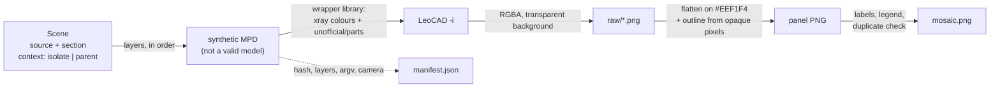
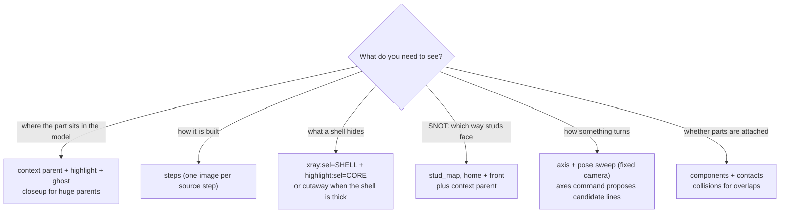
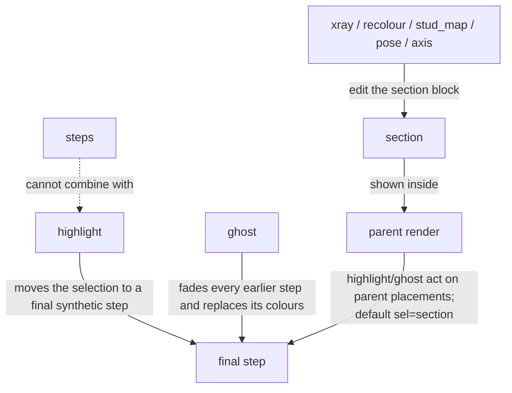

# Using ldraw-xray as an agent

This guide covers three things: which layers answer which question, how to read
the images, and which LeoCAD behaviours to expect.

ldraw-xray never judges a model. It shows what a synthetic copy looks like. You
decide what the picture means, and you check the source before claiming a fit.

## Setup

```sh
export LDRAW_DIR=/path/to/ldraw            # required (or pass -l/--ldraw-lib)
export LDRAW_SHADOW=/path/to/offLibShadow  # optional: LDCad connector metadata for overlays
export LEOCAD=/path/to/leocad              # optional when `leocad` is on PATH
ldraw-xray doctor                          # what was found and which layers can run
```

Without `LDRAW_SHADOW`, the core renders still work. Contacts and connected
groups then rely on pyldraw3's built-in detection and find fewer connections.

## Pipeline



## Which layers for which question



Rules of thumb from this project's inspection work:

- Check the parent before trusting a description. The DB names for submodels
  were wrong in about a third of the SNOT cases.
- Use steps rather than x-ray when the shell is thick or layered. X-ray helps
  for a thin shell over a few distinctively coloured parts (a V8 crank under its
  cylinder banks).
- Many walls are built flat and stood up by the parent's matrix. A stud map in
  section coordinates then shows "all up". Read `parent_placements` in the
  manifest, or render the map in context.
- Pick panels that differ. The mosaic reports panel pairs whose thumbnails
  differ by less than 7 (0–255 scale). The last source step usually looks like
  the finished isolated view.

## How the layers combine



- Out-of-band colours survive a ghost only on highlighted parts, because ghost
  replaces colours.
- Connection overlays (`components`, `contacts`, `collisions`) use the source
  geometry of the isolated section. They ignore poses.
- Most contact spheres sit between stacked parts and are hidden. Add
  `xray:sel=all` (applied before `contacts`) to see them through the parts.
- A group that touches only the section's bottom face usually connects to the
  storey or base below. Check it in context before calling it loose.

## Reading the images

| You see | It means |
|---|---|
| Magenta edges | Highlighted: new in this step, or selected. The fill keeps the part's colour |
| Pale grey, see-through parts | Ghosted context (`ghost`) |
| Neon green rod `#39FF14` | Synthetic axis marker, not a part |
| Lilac, rose, vermilion, electric blue, aqua, lime, violet | Stud map: up, +X, −X, +Z, −Z, down, odd angle |
| Group colours (`#3370FF`, `#00FFA6`, …) | Agent groups, or connected groups other than the largest |
| Small green / olive spheres | Detected contacts, confirmed / heuristic |
| Raspberry parts `#B2124A` | Overlap candidates (box overlap without a detected contact) |
| Dark stud sides | Stud style 6 rendering aid; not a colour of the part |
| Dark 2 px outline around the model | Traced silhouette, added after rendering |
| Open, hollow-looking parts in a cutaway | The clip plane cuts through meshes; cut faces are not capped |

All swatches are deliberately not LEGO colours (ΔE ≥ 16 from every LDConfig
colour), so a recoloured part is never mistaken for a real colour.

## Coordinates and framing

- LDraw −Y is up, and the front view looks toward +Z.
- `point` and `direction` options are in section coordinates. The manifest also
  records the axis mapped into the parent (`in_parent`).
- Cameras fit the parts' box corners: no cropping, and every step of one section
  shares a scale. Pose sweeps use one bounding-sphere camera (`camera:
  {"fixed": "home"}`), so rotating parts stay in frame.
- Cutaways need an axis-aligned view. LeoCAD's near plane is perpendicular to the
  view direction.

## LeoCAD behaviours (measured on 25.09)

| Behaviour | Consequence |
|---|---|
| The CLI uses the GUI's saved preferences for anything not passed | xray passes every visual setting explicitly |
| `-ec/-bec/-dec/-scc/-aec/-cc/-ldv` are ignored unless the stud style is 6 or 7 | The default style is `--stud-style 6 -aec -cc 1.0 -ldv 0.5` |
| `-i` writes RGBA with a transparent background | Images are flattened on a light backdrop. On dark `#303437`, a ghosted parent lost 76% of its outline; on light, 4% |
| White curved shells lose about 17% of their outline on light backdrops: LDraw has no edge lines on curved silhouettes | The opaque-pixel outline restores them |
| Direct colours (`0x2RRGGBB`) and model-local `!COLOUR` lines are ignored | xray adds its colours to a wrapper `LDConfig.ldr` |
| Embedded DAT blocks in an MPD can be dropped | They are written to the wrapper's `unofficial/parts/` with unique names |
| Recolouring a child's placement line leaves explicit colours inside it | `xray`/`recolour` flatten selected children first |
| `--zplanes NEAR FAR` clips perpendicular to the view direction | `cutaway` computes NEAR from the bounds and `depth` |

## Limits

- Renders show geometry. They do not prove clutch, clearance, travel or
  stability.
- Contacts come from pyldraw3 1.7 with a ported frame adapter for LDCad stud
  receptacles.
  - Technic pin/axle mating is not paired, so a pin-mounted part can show up as
    its own "floating" group.
  - Overlap candidates come from axis-aligned boxes: rotated parts give false
    candidates.
- Parts unknown to the library, such as some embedded DATs, are skipped for
  bounds. The manifest notes which.
